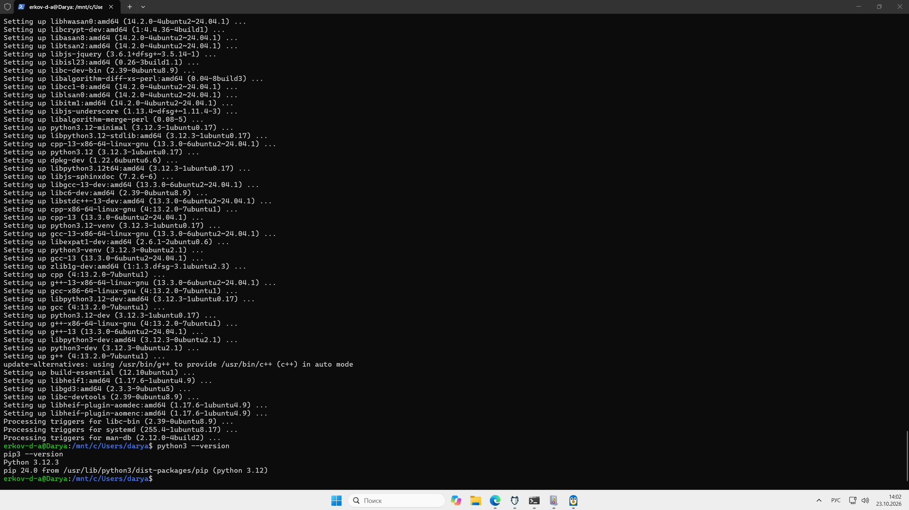
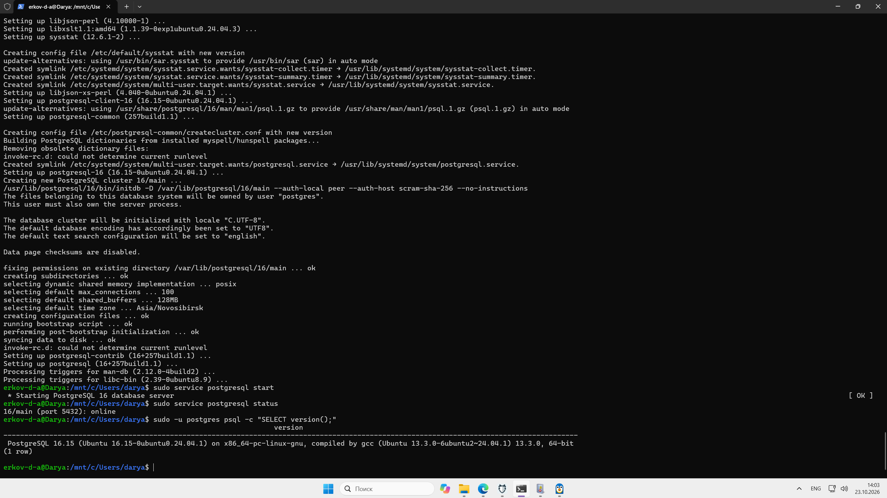
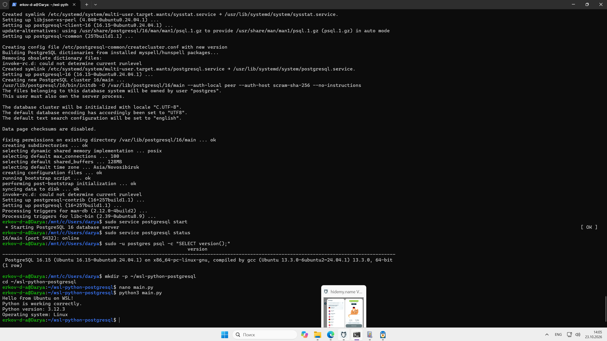

## 1. Цель работы

Установить и проверить WSL, Ubuntu, интерпретатор Python и систему управления базами данных PostgreSQL.

## 2. Установка и проверка Ubuntu

Установлен дистрибутив Ubuntu 24.04 LTS. После запуска создан пользователь Linux.




## 3. Установка Python

Python и необходимые инструменты установлены командами:

```bash
sudo apt update
sudo apt install -y python3 python3-pip python3-venv
```

Проверка версий:

```bash
python3 --version
pip3 --version
```

Результат: Python 3.12.3 и pip 24.0.


## 4. Установка PostgreSQL

Установка:

```bash
sudo apt install -y postgresql postgresql-contrib
```

Запуск сервера:

```bash
sudo service postgresql start
```

Проверка состояния и версии:

```bash
sudo service postgresql status
sudo -u postgres psql -c "SELECT version();"
```

Результат: PostgreSQL 16.15, сервер работает на порту 5432.




## 5. Проверка Python-программы

Создан файл `main.py`, который выводит приветствие, версию Python и операционную систему.

Запуск:

```bash
python3 main.py
```




